<div align="center">


<br>

[](https://369web.ir)
[](#-دموهای-زنده)
[](#)
[](#-ساختار-فرانت‌اند)

</div>

<div dir="rtl">

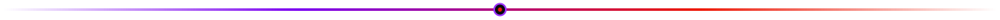

## ✦ درباره پروژه

**۳۶۹ وب** پلتفرمی است که خرید هاست، دامنه و یک وب‌سایت کامل را به یک فرایند چنددقیقه‌ای تبدیل می‌کند. مشتری پلن هاست را انتخاب می‌کند، دامنه می‌گیرد، از بین **۱۲ نوع سایت آماده** یکی را برمی‌گزیند و کسب‌وکارش را توصیف می‌کند. بعد از پرداخت، اکانت cPanel به‌صورت خودکار ساخته می‌شود، سایت روی آن نصب و با هوش مصنوعی شخصی‌سازی می‌شود و مشتری پنل مدیریت فارسی سایتش را تحویل می‌گیرد.

> ℹ️ **توجه:** این مخزن فقط شامل **بخش فرانت‌اند** پروژه است: سیستم طراحی، استایل‌ها، اسکریپت‌های رابط کاربری، تصاویر و مستندات. کدهای سمت سرور (PHP، پایگاه داده، اتصال به WHM، درگاه پرداخت، پیامک و هوش مصنوعی) در این مخزن منتشر نمی‌شوند.

<div align="center">

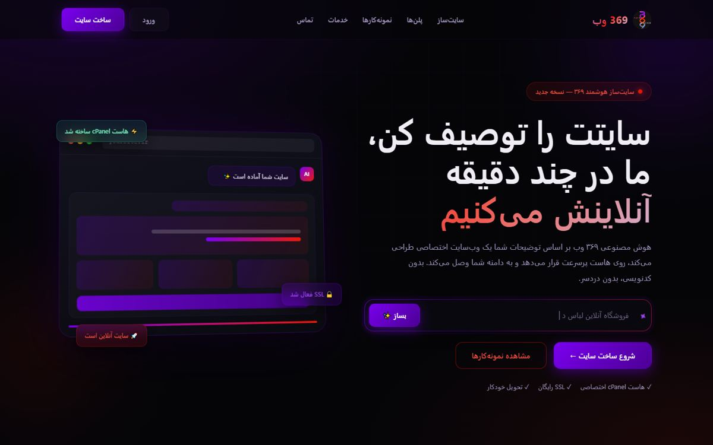

<sub>صفحه اصلی پلتفرم — تم تیره نئونی با پالت بنفش و قرمز</sub>

</div>


## 📑 فهرست

- [مسیر سفارش تا تحویل](#-مسیر-سفارش-تا-تحویل)
- [امکانات کلیدی](#-امکانات-کلیدی)
- [۱۲ نوع سایت آماده](#-۱۲-نوع-سایت-آماده)
- [دموهای زنده](#-دموهای-زنده)
- [پنل‌های مدیریت](#-پنل‌های-مدیریت)
- [پالت رنگی و سیستم طراحی](#-پالت-رنگی-و-سیستم-طراحی)
- [ساختار فرانت‌اند](#-ساختار-فرانت‌اند)
- [کامپوننت‌ها و ماژول‌های جاوااسکریپت](#-کامپوننت‌ها-و-ماژول‌های-جاوااسکریپت)
- [واکنش‌گرایی و دسترس‌پذیری](#-واکنش‌گرایی-و-دسترس‌پذیری)
- [استفاده از استایل‌ها](#-استفاده-از-استایل‌ها)
- [تیم](#-تیم)


## 🛤 مسیر سفارش تا تحویل

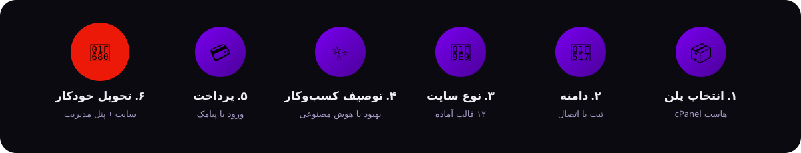

| مرحله | چه اتفاقی می‌افتد؟ |
|:---:|---|
| **۱. پلن** | انتخاب پلن هاست cPanel با قیمت ماهانه یا سالانه |
| **۲. دامنه** | ثبت دامنه جدید با بررسی آنی آزاد بودن، یا اتصال دامنه فعلی |
| **۳. نوع سایت** | انتخاب از بین ۱۲ نوع سایت آماده با پیش‌نمایش زنده |
| **۴. توصیف** | نوشتن توضیحات کسب‌وکار و بهبود آن با یک کلیک توسط هوش مصنوعی |
| **۵. پرداخت** | ورود یا ثبت‌نام با کد پیامکی و پرداخت آنلاین |
| **۶. تحویل** | ساخت خودکار هاست، نصب سایت، شخصی‌سازی محتوا و تحویل پنل مدیریت |


## ⚡ امکانات کلیدی

<table>
<tr>
<td width="50%" valign="top">

### 🧩 سایت‌های آماده و کامل
هر نوع سایت امکانات اختصاصی خودش را **از قبل** دارد: منوی آنلاین، فروشگاه، دوره آموزشی، نوبت‌دهی، رزرو و… . ساختار سایت را هوش مصنوعی نمی‌سازد؛ پس هیچ‌وقت ناقص یا خراب تحویل داده نمی‌شود.

</td>
<td width="50%" valign="top">

### 🤖 شخصی‌سازی با هوش مصنوعی
متن‌ها، رنگ‌ها و محتوای اولیه سایت بر اساس توضیحات مشتری نوشته می‌شود. دکمه «✨ نوشتن با هوش مصنوعی» هم کنار همه فیلدهای متنی پنل مدیریت قرار دارد.

</td>
</tr>
<tr>
<td valign="top">

### 🖥️ مدیریت هاست با یک کلیک
داشبورد مشتری شامل تاریخ شروع و انقضا، روزهای باقی‌مانده، فضای مصرفی، تمدید آنلاین و ورود بدون رمز به cPanel است.

</td>
<td valign="top">

### 📣 استودیو محتوا
تولید پست برای تلگرام و اینستاگرام، ساخت تصویر و کاور، بسته کامل ویدیوی یوتیوب، زمان‌بندی انتشار و برنامه انتشار خودکار روزانه.

</td>
</tr>
<tr>
<td valign="top">

### 🏠 صفحه اصلی کاملاً قابل مدیریت
همه بخش‌ها، متن‌ها، رنگ‌ها، منو و ترتیب بخش‌ها از پنل مدیریت و با کشیدن و رها کردن تغییر می‌کند.

</td>
<td valign="top">

### ⭐ پلتفرم‌های منتخب و لینک‌های اختصاصی
نمایش ویژه محصولات خود تیم در صفحه اصلی، و دکمه‌های قابل تعریف در داشبورد همه مشتریان (مثلاً اشتراک پلتفرم هوش مصنوعی).

</td>
</tr>
</table>


## 🧱 ۱۲ نوع سایت آماده

<table>
<tr>
<td align="center" width="33%">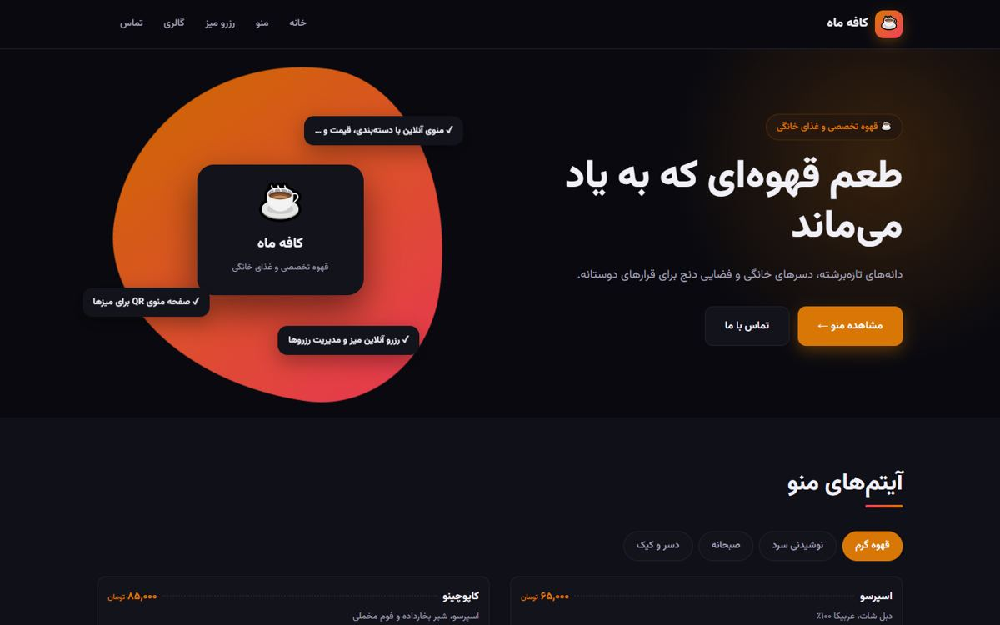<br><b>☕ کافه و رستوران</b><br><sub>منوی آنلاین با دسته‌بندی و قیمت · منوی QR · رزرو میز</sub></td>
<td align="center" width="33%">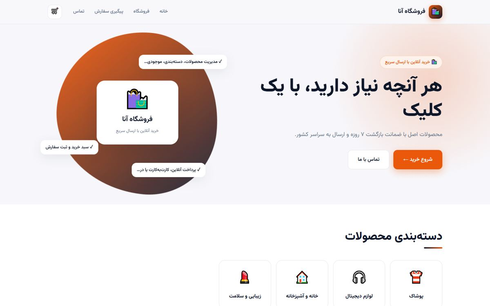<br><b>🛍️ فروشگاه اینترنتی</b><br><sub>محصول، تخفیف، موجودی · سبد خرید · پرداخت و پیگیری سفارش</sub></td>
<td align="center" width="33%">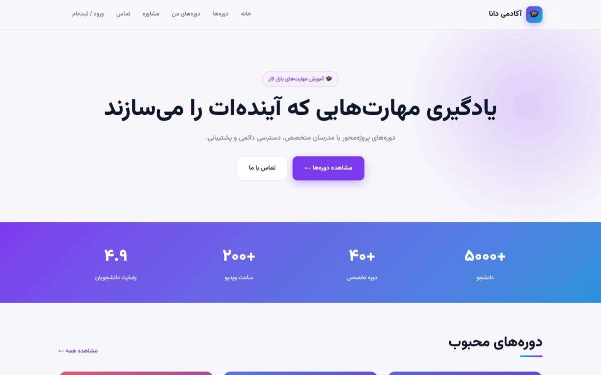<br><b>🎓 آموزشگاه و دوره آنلاین</b><br><sub>دوره، فصل و جلسه ویدیویی · ثبت‌نام دانشجو · «دوره‌های من»</sub></td>
</tr>
<tr>
<td align="center">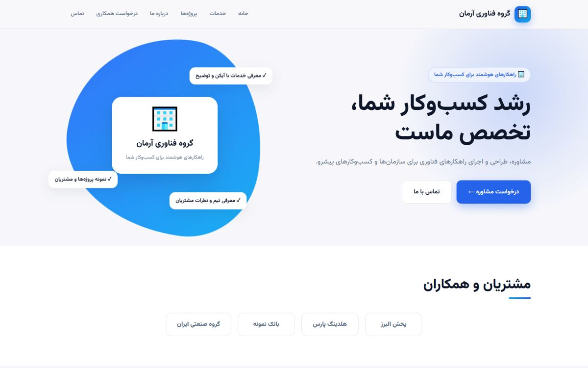<br><b>🏢 شرکتی و سازمانی</b><br><sub>خدمات · پروژه‌ها · تیم و مشتریان · استعلام قیمت</sub></td>
<td align="center">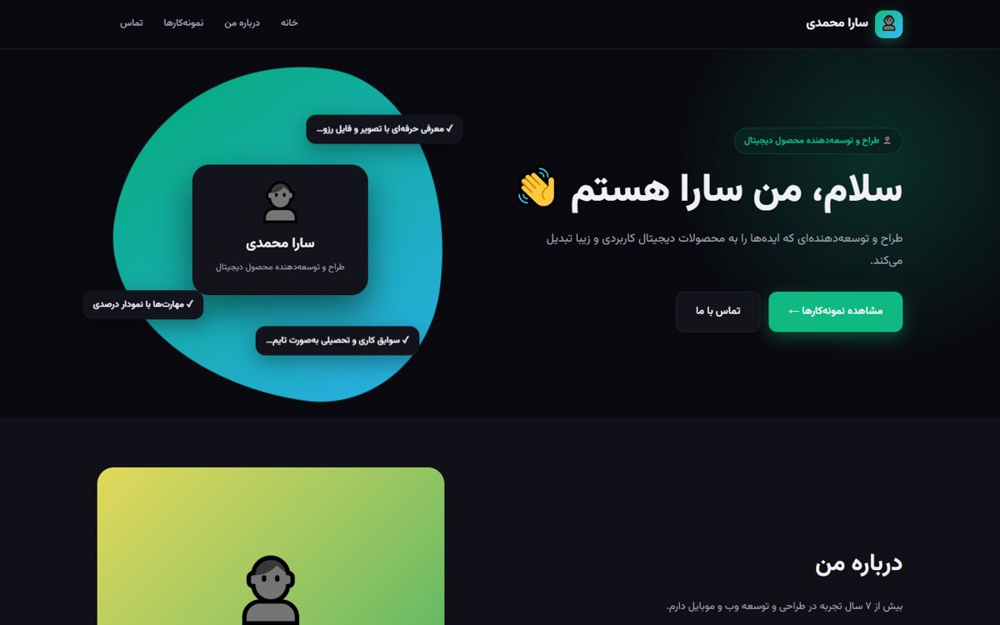<br><b>👤 شخصی و رزومه</b><br><sub>مهارت‌ها · سوابق کاری و تحصیلی · نمونه‌کارها</sub></td>
<td align="center">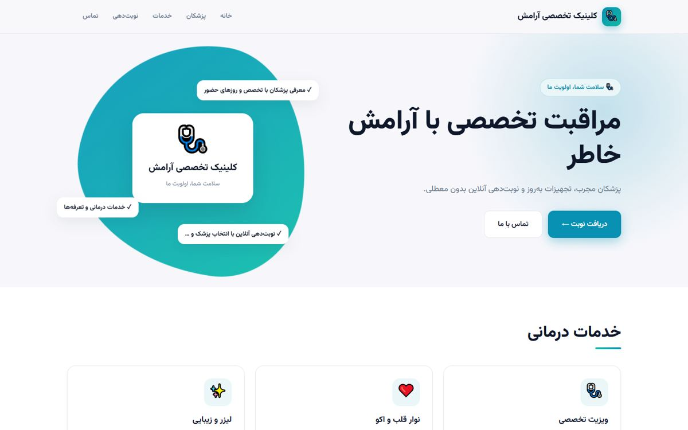<br><b>🩺 پزشکی و کلینیک</b><br><sub>پزشکان · خدمات و تعرفه · نوبت‌دهی آنلاین · بیمه‌ها</sub></td>
</tr>
<tr>
<td align="center">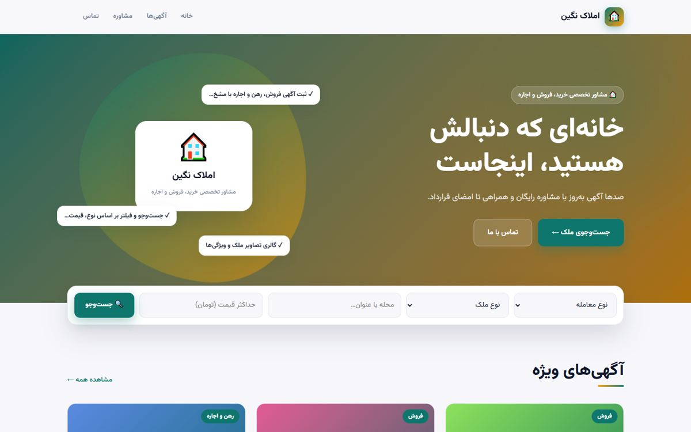<br><b>🏠 املاک و مشاور مسکن</b><br><sub>آگهی فروش و اجاره · جست‌وجو و فیلتر · درخواست بازدید</sub></td>
<td align="center">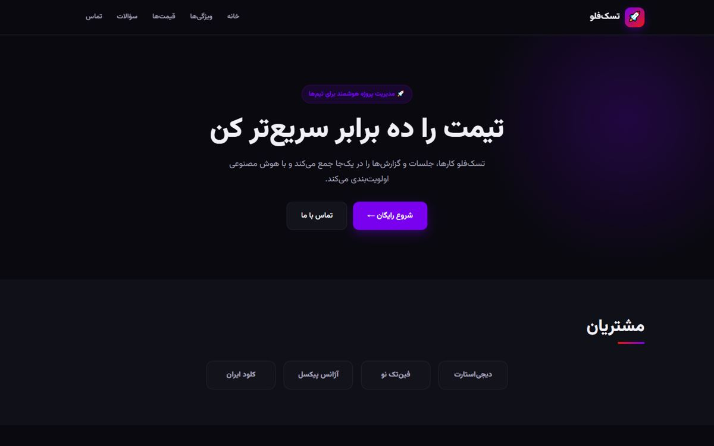<br><b>🚀 استارتاپ و محصول دیجیتال</b><br><sub>ویژگی‌ها · جدول قیمت · لیست انتظار · سؤالات متداول</sub></td>
<td align="center">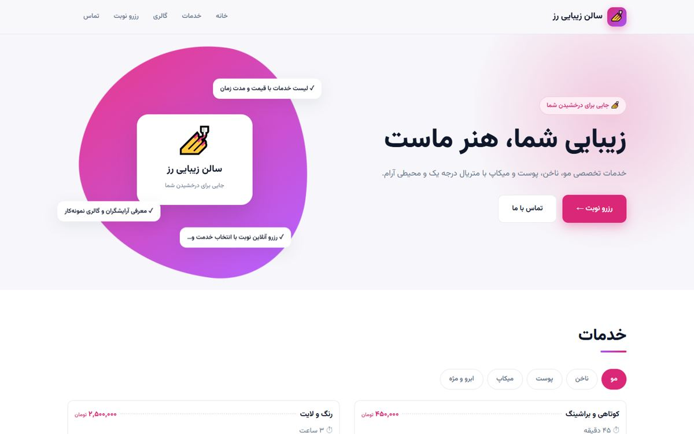<br><b>💅 سالن زیبایی</b><br><sub>خدمات با قیمت و زمان · آرایشگران · رزرو نوبت</sub></td>
</tr>
<tr>
<td align="center">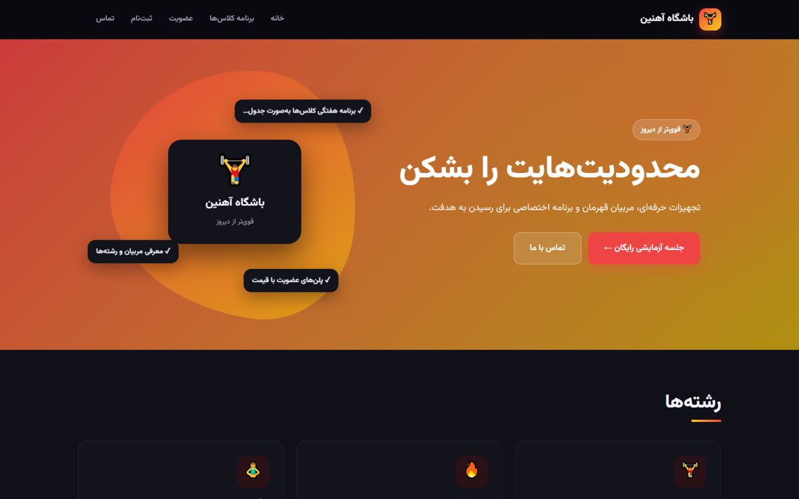<br><b>🏋️ باشگاه ورزشی</b><br><sub>جدول هفتگی کلاس‌ها · مربیان · پلن‌های عضویت</sub></td>
<td align="center">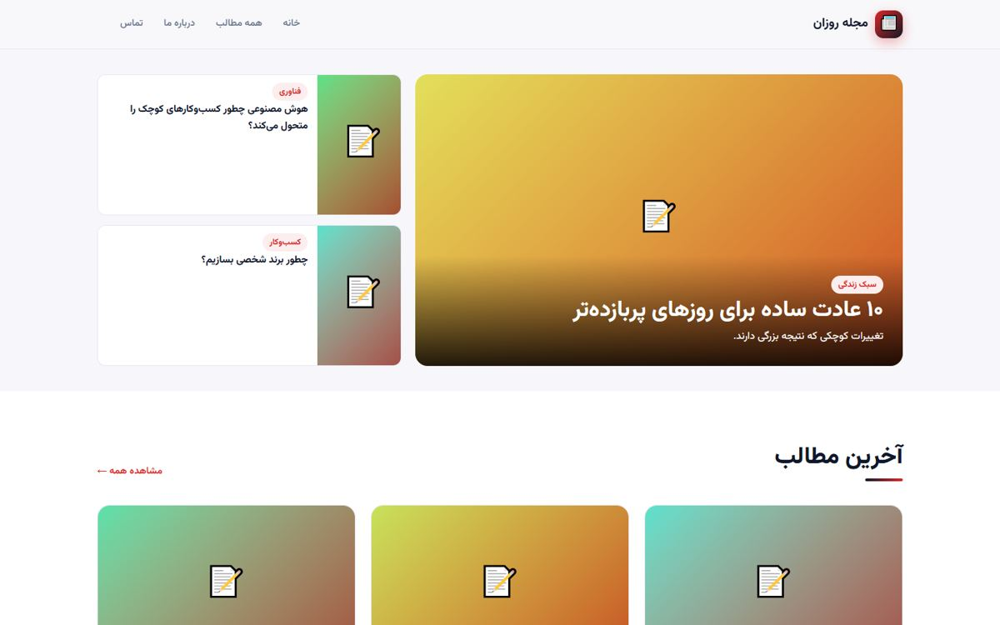<br><b>📰 مجله خبری و بلاگ</b><br><sub>چیدمان مجله‌ای · دسته‌بندی · نظرات · خبرنامه</sub></td>
<td align="center">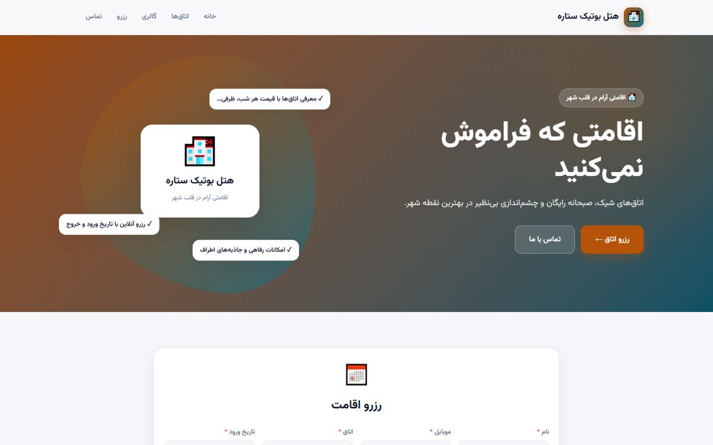<br><b>🏨 هتل و اقامتگاه</b><br><sub>اتاق‌ها و امکانات · رزرو با تاریخ ورود و خروج</sub></td>
</tr>
</table>

> هر سایت در حالت **روشن** یا **تیره**، با سه چیدمان هیرو (دوستونه، وسط‌چین، تمام‌عرض) و رنگ‌های دلخواه مشتری نمایش داده می‌شود.


## 👁 دموهای زنده

<div align="center">

| | | | |
|:---:|:---:|:---:|:---:|
| [☕ کافه](https://369web.ir/s369/demo/cafe/) | [🛍️ فروشگاه](https://369web.ir/s369/demo/shop/) | [🎓 آموزشگاه](https://369web.ir/s369/demo/edu/) | [🏢 شرکتی](https://369web.ir/s369/demo/corporate/) |
| [👤 شخصی](https://369web.ir/s369/demo/personal/) | [🩺 پزشکی](https://369web.ir/s369/demo/medical/) | [🏠 املاک](https://369web.ir/s369/demo/estate/) | [🚀 استارتاپ](https://369web.ir/s369/demo/startup/) |
| [💅 زیبایی](https://369web.ir/s369/demo/beauty/) | [🏋️ باشگاه](https://369web.ir/s369/demo/gym/) | [📰 مجله](https://369web.ir/s369/demo/news/) | [🏨 هتل](https://369web.ir/s369/demo/hotel/) |

</div>

پنل مدیریت هر دمو از مسیر `/admin` همان دمو در دسترس است (نام کاربری `demo` و رمز `demo1234`). در حالت دمو امکان دیدن همه بخش‌ها هست، ولی تغییرات ذخیره نمی‌شود.


## 🛠 پنل‌های مدیریت

<table>
<tr>
<td width="68%" valign="top">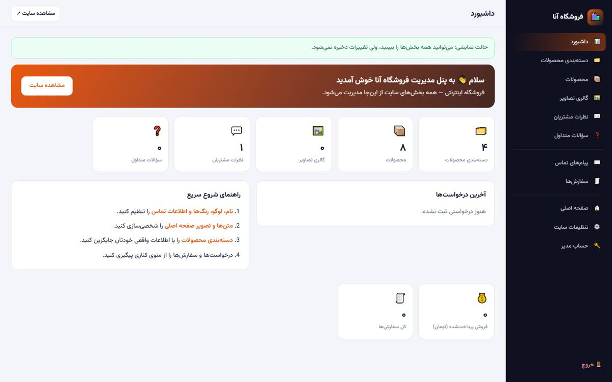</td>
<td width="32%" valign="top">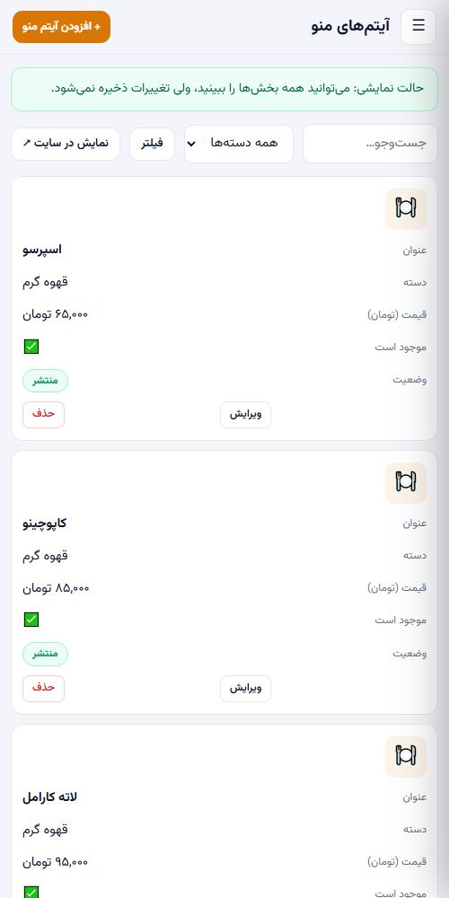</td>
</tr>
</table>

| پنل | امکانات |
|---|---|
| **مدیریت سایت مشتری** | افزودن و ویرایش محتوا با آپلود تصویر و گالری · مرتب‌سازی با کشیدن و رها کردن · صندوق درخواست‌ها با وضعیت و خروجی اکسل · سفارش‌ها · دانشجویان و ثبت‌نام‌ها · تأیید نظرات · ویرایش صفحه اصلی · رنگ و حالت نمایش · درگاه پرداخت اختصاصی · اتصال به گوگل |
| **داشبورد مشتری ۳۶۹ وب** | اکانت‌های هاست با حلقه روزهای باقی‌مانده · ورود به cPanel و مدیریت سایت با یک کلیک · تمدید · پیگیری لحظه‌ای سفارش · استودیو محتوا · سرویس‌های بیشتر |
| **مدیریت پلتفرم** | همگام‌سازی با WHM · تعریف مشتری و مالکیت اکانت‌ها · تاریخ انقضا و تعلیق · سفارش‌ها و پرداخت‌ها · پلن‌ها · نوع‌های سایت و دموها · نمونه‌کارها · پلتفرم‌های منتخب · ویرایشگر کامل صفحه اصلی · تنظیمات و گزارش‌ها |


## 🎨 پالت رنگی و سیستم طراحی

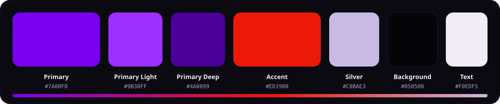

همه رنگ‌ها به‌صورت متغیر CSS تعریف شده‌اند و رنگ اصلی و مکمل از پنل مدیریت قابل تغییر است. سایر سایه‌ها با `color-mix()` از همین دو رنگ ساخته می‌شوند:

<div dir="ltr">

```css
:root {
  --primary: #7A00F0;        /* بنفش برند */
  --accent:  #ED1908;        /* قرمز برند */
  --primary-light: color-mix(in srgb, var(--primary) 75%, #fff);
  --primary-deep:  color-mix(in srgb, var(--primary) 62%, #000);
  --silver: #C8BAE3;
  --bg: #050508;  --bg2: #0A0A10;  --bg3: #0F0F18;
  --text: #F0EDF5;  --text-muted: #A99BC8;  --text-dim: #7B6E96;
  --r-sm: 10px;  --r-md: 16px;  --r-lg: 20px;  --r-xl: 26px;
}
```

</div>

| توکن | کاربرد |
|---|---|
| `--primary` / `--accent` | دکمه‌ها، گرادیان‌ها، نئون‌ها و حالت‌های فعال |
| `--silver` | گرادیان متن‌های شاخص و جزئیات ظریف |
| `--bg*` | لایه‌های پس‌زمینه تیره با عمق |
| `.glass` | کارت‌های شیشه‌ای با `backdrop-filter` و حاشیه بنفش کم‌رنگ |
| `.gradient-text` | متن گرادیانی متحرک بنفش، قرمز و نقره‌ای |
| `.spot` | نور دنبال‌کننده نشانگر ماوس روی کارت‌ها |

**تایپوگرافی:** فونت وزیر و وزیرمتن، چیدمان کامل راست‌به‌چپ، اعداد فارسی و تاریخ شمسی.


## 📂 ساختار فرانت‌اند

<div dir="ltr">

```text
369web/
├── src/
│   ├── platform/                 ← رابط کاربری پلتفرم اصلی (369web.ir)
│   │   ├── app.css               design system, landing, order wizard, dashboards, studio
│   │   └── app.js                interactions, wizard, OTP, CMS editor, studio UI
│   └── site-engine/              ← قالب سایت‌های آماده مشتریان
│       ├── site.css              public theme (light/dark, 12 site types, 15+ displays)
│       ├── site.js               cart, tabs, lightbox, ajax forms, reveal
│       ├── admin.css             site owner dashboard
│       └── admin.js              uploads, gallery, drag-sort, markdown bar, AI writer
└── docs/
    ├── svg/                      banner, palette, flow, divider
    └── screenshots/              12 demos + platform + dashboards
```

</div>

- **بدون فریم‌ورک و بدون مرحله build:** CSS و JavaScript خالص (ES5 به بالا)، بدون jQuery و بدون کتابخانه خارجی.
- **حجم کم:** کل جاوااسکریپت سایت مشتری کمتر از ۵ کیلوبایت است.


## 🧠 کامپوننت‌ها و ماژول‌های جاوااسکریپت

<details open>
<summary><b>پلتفرم — <code>src/platform</code></b></summary>

| ماژول | توضیح |
|---|---|
| Hero & Prompt Box | کادر «سایتت را توصیف کن» با placeholder تایپ‌شونده و پنجره متحرک ساخت سایت |
| Order Wizard | سفارش ۵ مرحله‌ای با Stepper، اعتبارسنجی هر مرحله، بررسی دامنه، انتخاب نوع سایت و جمع‌بندی زنده قیمت |
| OTP Box | ورود و ثبت‌نام با کد پیامکی، شمارش معکوس و ارسال خودکار کد |
| Live Order Status | پیگیری لحظه‌ای مراحل ساخت هاست و نصب سایت |
| CMS Editor | ویرایشگر صفحه اصلی با تب‌ها، Repeater، آپلود تصویر و مرتب‌سازی بخش‌ها با کشیدن |
| Content Studio | تولید و ویرایش محتوا، پیش‌نمایش تصویر، زمان‌بندی، دریافت پیج‌های اینستاگرام و بسته یوتیوب |
| Responsive Tables | تبدیل خودکار جدول‌ها به کارت در موبایل با برچسب‌گذاری سلول‌ها |

</details>

<details open>
<summary><b>موتور سایت — <code>src/site-engine</code></b></summary>

| نمایش | کاربرد |
|---|---|
| `menu` | منوی گروه‌بندی‌شده با تب، قیمت، برچسب و وضعیت موجودی |
| `product` / `cats` | کارت محصول با تخفیف و افزودن به سبد، شبکه دسته‌بندی‌ها |
| `course` / `lessons` | کارت دوره، سرفصل‌های قفل‌دار و پخش‌کننده ویدیو (mp4، آپارات و یوتیوب) |
| `listing` | آگهی ملک و اتاق هتل با مشخصات و قیمت |
| `schedule` | جدول هفتگی کلاس‌های باشگاه |
| `pricing` / `steps` / `faq` | جدول قیمت، مراحل کار و آکاردئون سؤالات |
| `profile` / `testimonial` / `logo` | تیم، نظرات مشتریان و لوگوها |
| `timeline` / `skill` | سوابق رزومه و نوار مهارت‌ها |
| `gallery` | گالری با لایت‌باکس |
| `magazine` | هیرو مجله‌ای برای سایت خبری |

در پنل مدیریت: آپلود با نوار پیشرفت، گالری چندتصویری با جابه‌جایی، انتخابگر ایموجی، نوار ابزار متن، فیلد قیمت با جداکننده و دکمه نوشتن با هوش مصنوعی.

</details>


## 📱 واکنش‌گرایی و دسترس‌پذیری

<table>
<tr>
<td width="30%">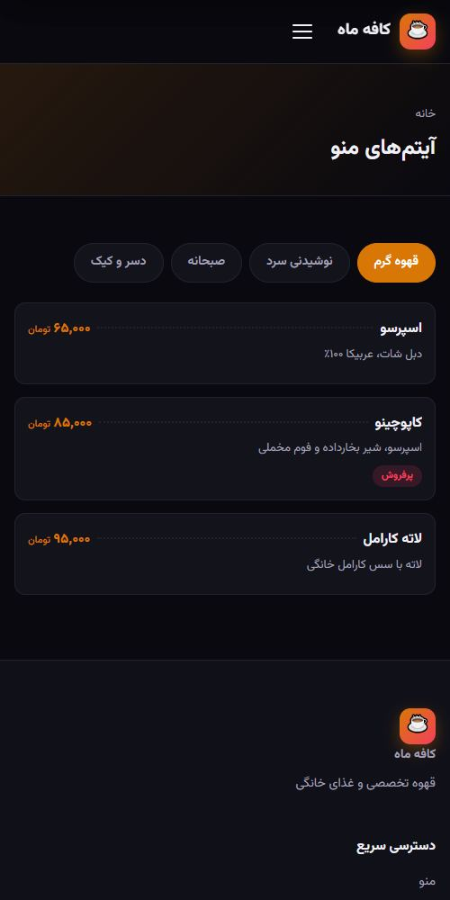</td>
<td valign="top">

- **سه نقطه شکست اصلی:** `1024px`، `768px` و `480px`
- منوی کشویی موبایل و سایدبار داشبورد با پوشش تیره و بستن با کلید <kbd>Esc</kbd>
- جدول‌های مدیریتی در موبایل به کارت تبدیل می‌شوند
- اسکرول‌بار نازک با گرادیان بنفش و قرمز
- پشتیبانی از `prefers-reduced-motion` برای کاربرانی که انیمیشن را غیرفعال کرده‌اند
- ساختار معنایی HTML، برچسب‌های `aria` و فوکوس قابل مشاهده
- تبدیل خودکار اعداد فارسی به لاتین در فیلدهای عددی
- تصاویر با `loading="lazy"` و انیمیشن‌ها با `IntersectionObserver`

</td>
</tr>
</table>


## 🧪 استفاده از استایل‌ها

فایل‌ها مستقل هستند و در هر صفحه HTML راست‌به‌چپ قابل استفاده‌اند:

<div dir="ltr">

```html
<html lang="fa" dir="rtl" data-mode="dark">
<head>
  <link rel="stylesheet" href="https://cdn.jsdelivr.net/gh/rastikerdar/vazirmatn@v33.003/Vazirmatn-font-face.css">
  <link rel="stylesheet" href="src/site-engine/site.css">
  <style>:root{ --p:#7A00F0; --a:#ED1908 }</style>
</head>
<body>
  <section class="hero hero-split">
    <div class="wrap hero-in">
      <div class="hero-txt">
        <span class="kicker">🚀 نسخه جدید</span>
        <h1>عنوان شما</h1>
        <a class="btn btn-p btn-lg" href="#">شروع کنید ←</a>
      </div>
    </div>
  </section>
  <script src="src/site-engine/site.js"></script>
</body>
</html>
```

</div>

- برای تم روشن، `data-mode="light"` بگذارید.
- با تغییر `--p` و `--a`، کل رنگ‌بندی سایت عوض می‌شود.


## 👥 تیم

<div align="center">

**تیم توسعه نرم‌افزاری و ارتقا تکنولوژی ۳۶۹ وب**

مهندس سید علیرضا فاطمی · Guru Uchiha

[🌐 369web.ir](https://369web.ir) · [✉️ info@369web.ir](mailto:info@369web.ir) · [⬡ github.com/deveguru](https://github.com/deveguru)

<br>

<sub>© ۱۴۰۵ تیم ۳۶۹ وب — تمامی حقوق محفوظ است.</sub>

</div>

</div>
